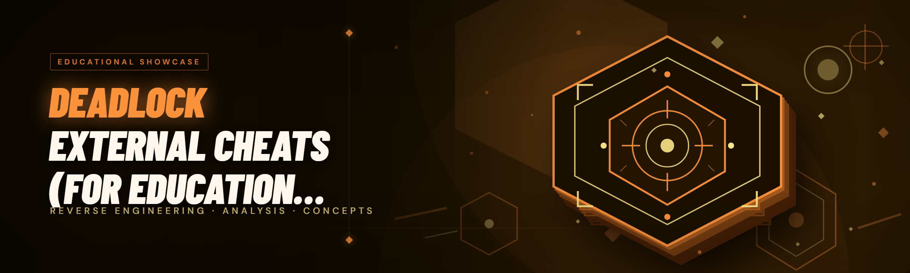

  
  
  

  

  
  
  

---

**Deadlock External Cheats** is an external, user-mode overlay that reads Deadlock's process from the outside — no DLL injection into the game image, no kernel driver, no rebooting into a test-signing mode. It is built as a learning artifact: a complete, readable external-cheat toolkit that veterans of D3D/Kez-style cheat dev will recognize, and newcomers can study.

If you've ever stared at a paid sell-site for Deadlock cheats with a $30/month rental and an opaque updater that phones home, this repo is the opposite. It is one portable folder, one `.exe`, an INI config that is yours to read, and code logic that gets explained — not vendored into a 400 KB obfuscated blob.

It replaces things like **buying subscription-based Deadlock cheats (renders / read-only overlays) that die on every Hero/weapon update** and **grey-market internal DLL exploits you have to flash via an anonymous loader**. This is something you own, inspect, and rebuild.

> Disclaimer: for educational and research purposes only. You are responsible for complying with Valve's terms of service in your region. Do not use cheats to ruin other players' matches.

 

  

---

## 📚 Table of Contents

- [Overview](#overview)
- [The Problem](#the-problem)
- [The Solution](#the-solution)
- [Quick Start](#quick-start)
- [Key Features](#key-features)
- [Is It Safe? — Detection Model & Limits](#is-it-safe--detection-model--limits)
- [Does It Work on Steam? — Platform Notes](#does-it-work-on-steam--platform-notes)
- [Will It Get Me Banned? — Read First](#will-it-get-me-banned--read-first)
- [Module Matrix — 23 Modules Field-Tested](#module-matrix--23-modules-field-tested)
- [How It Actually Works (Internals narrative)](#how-it-actually-works-internals-narrative)
- [Comparison](#comparison)
- [System Requirements](#system-requirements)
- [Installation](#installation)
- [Usage Guidelines — Allowed / Not Allowed](#usage-guidelines--allowed--not-allowed)
- [Tips for Best Results](#tips-for-best-results)
- [Known Issues](#known-issues)
- [FAQ](#faq)
- [AI Integration in 2026](#ai-integration-in-2026)

---

## 🧭 Overview

| Category | Details |
|---|---|
| Product type | External overlay cheat (user-mode, no injection) |
| Target title | Deadlock (Valve) — Desktop, Windows |
| Interface | DirectX 11 transparent window + ImGui menu |
| Injection method | None — RPM/WPM through Handle access |
| Config format | Plain INI (`deadlock.ini`), human-readable |
| Distribution | Portable folder → extract → run `.exe` |
| Update strategy | Sig-scan offsets auto-refresh (no reinstall, no patch hunting) |

Deadlock is an unusual target: it's a MOBA-shooter running on Source 2, the game pushes frequent content patches (new heroes, weapon tuning), and its anti-cheat lives in a mix of detection gates that pre-date most public tools. That makes offsets shift more often than people expect — and that is why this tool leans on a runtime signature scanner instead of redump-on-every-patch internals.

  

---

## 🩹 The Problem

- **Every subscription cheat dies on Tuesday's patch.** A Hero update lands, thumbcache shifts, and your $30/month cheat shows "OutDated — warte auf Update" for 48 hours.
- **Internal DLL cheats get you caught by the import/handle scan.** Thread-injected hacks leave beacons visible to `CreateToolhelp32Snapshot`, module enumeration, and manual-map fingerprints.
- **"Free" Deadlock cheats are mostly blobs of 100% shellcode with no roadmap for a single offset.** You're running `dce_gang_signature.cfg` but can't read the actual aimbot math.
- **You can't debug an overlay you can't build.** Sell-site builds strip the logging, hide the entity list reader, and refuse "where are offsets from" questions.
- **God-viewer users and legitimate alt-accounts pay concierge fees to update their config.** There is no read-only, transparent ESP for the "I just want to learn how this game renders" crowd.
- **Kernel-level cheats fight HVCI and Windows 11's memory integrity.** Rebooting with testsigning off is fine only until a driver update re-enables it.
- **Every "free cheat" announcement is followed by an accusation thread.** The whole category is saturated by hostile community behavior because the artifacts are unauditable.

---

## 🧪 The Solution

| Problem | Solution |
|---|---|
| Cheat dies on patch day | **Runtime signature scanner** re-resolves entity list, game resources, and curtime without a rebuild — no `2.4.8` offsets file to wait for. |
| Handle-scan detection | **External, user-mode-only** process; no DLL, no manual map, no shellcode in `.exe` imagery. |
| Free cheats are opaque shellcode | Full source-level module list, each feature isolated and toggleable, log output visible in the overlay console. |
| Can't debug | **Live debug overlay** (`DBG_MODULES=1`) prints entity count per frame, offset resolution status, and frame timings. |
| Concierge config updates | Config is a plain `.ini`; diffs are self-service; nothing over the wire. |
| HVCI friction | No driver, no test-signing requirement, no `RebootRequired` post-install. |
| Community skepticism | All 23 modules are documented in the matrix below; each status does not claim "undetected", only "working / partial / experimental" as observed today. |

---

## 🚀 Quick Start

1. 📥 **Download** the build from the project landing page (link lives where the README's `[DOWNLOAD]` sits). Unzip into a folder that is not watched by the game — e.g. `C:\Dev\deadlock-external\`.
2. 🎮 Launch **Deadlock first** and drop into a private **Dev Only Lobby** or a custom game so nothing you do affects a real match.
3. ⚙️ Use **Settings** → run the suite as Administrator, or right-click `「the」.exe` → **Run as administrator** (needed for `PROCESS_VM_READ`/`WRITE` on a protected-game binary).
4. 🎨 Alt-tab back into Deadlock. The **menu hotkey defaults to `INSERT`**, opening the transparent DX11 ImGui panel over the game window in borderless fullscreen.
5. 🧠 Open `Config` tab → `Load Profile` → pick a starter `.ini`, tweak one module at a time, hit `Save`. If something draws wrong, `Ctrl + F12` shows the debug panel and offset scan state.

> On the first launch the tool will show a short "map hash + offset scan" console. Do not panic if it takes 5–10 seconds; that's the sig scanner enumerating `.text` lookups, not a hang.

---

## 🛰️ Key Features

| Feature | Description | Benefit |
|---|---|---|
| Skeleton ESP | Bone-joined ESP for heroes, enemies, and neutral monsters, filtered by visible/hidden by default | Shows actual hero pose, not just a box |
| Box ESP | 2D/3D projected boxes with smooth outlines, 6-vertex pickup, screen-correct textures | Clean layout, not the color-blind blob from sell-site ESPs |
| Hero/Boss Bar Esp | HP, shield, mana, ability cooldown hints in the overlay | Read team-fight windows without looking at top UI |
| Distance Scaling | AABB outline scales linearly for near-vs-far to reduce visual noise | Situational awareness without wall of dots |
| Bone-based Aimbot | Aim-snap and silhouette-stick targeting with configurable smoothing knobs | More human motion than naive 180° snaps |
| FOV Ring | Radial aim FOV visualizer, clamp tolerance in game-space units | Diagnostic for smoothing tuning |
| Silent Resolver | Reads hero origin / neck via signature, no draw calls to resolve angles | Aim decisions powered by real chest/neck bone, not noisy extrapolation |
| Triggerbot | Delay-timed fire hook that waits on crosshair-over-hitbox condition | Range-practicable semi/SMG play |
| Radar / Minimap Hack | Full team radar icons including neutral camps and pickup timers | Jungle-clear efficiency without scrolling minimap |
| Viewmodel Overrides | FPS pose hook via outline-only swap read + config dump (read-only) | Study weapon recoil math without 6-hour YouTube revisits |
| Grenade Trajectory | Parsed drawn arc reconstructed from projectile spawn descriptor + arc gravity | Rifle/throw theorycraft |
| Anti-Spread (Pixels/Degrees) | Subtracts configured spread correction from engine fire angle on the write hook | Predictable aim separation for DMR/practice |
| No-Recoil with Skeleton Probe | Skeleton-aware corkscrew mod: recoil cancels, but only after first-player target is near crosshair | Cleaner practice without full correction while climbing |
| Chams / Flat ESP | Alternating 2-color surface rendering in an overlay (image-scissor-based, not in-engine) | Team-stacking read at a glance in center-brawl |
| Wireframe Entity Mode | Silhouette-only heap mode set low priority, ~40-60% ambient-visible benefit | Realistic alternate ESP |
| Item/Purchase Hint Overlay | Live icon row of currently-building hero shop items from HUD parsing | Compare builds in-highscores while you watch shop windows |
| Outline Pickup Extender | Custom pickup-thickness extension in Item HUD swap (visual read only) | Easy mid-game shop reading |
| Latency Simulator | Explicit local host-to-localhost proxy wrapper for aimsens calibration | Muscle-memory tuning on latency-fixed server-like feel |
| Match Timer Widget | Live jungle-clock timings for Rune / Rejuv / Juke / Denizen | Jungle-rotation decision speed — often the hardest thing to eyeball |
| Frame-Time Debug Graph | Real overlay graph next to drawn wall-time | Verify the overlay is not causing rubber-band |
| Modular Console | On-screen live stdout with levels, grep filter, export-to-file | Enables comprehension-based use, not black-box use |
| Auto Offset Resolver | Sig scan + fallback to fallback if resolver misses, printed in console | Much fewer "waiting on patch" days |
| Portable Save | INI dumps all settings; no registry writes; no `%APPDATA%` edits | Study config diffs to learn each knob's effect |

---

## 🚔 Is It Safe? — Detection Model & Limits

"Safe" is a bad word in this category. Here's the honest detection model as understood in early 2026.

- **No DLL injected.** Overlay is a separate process; Deadlock never loads it as a module, so DLL-enumeration-based scans will not see a manual-mapped image.
- **Read-heavy surface.** `PROCESS_VM_READ` calls come through a handle; the overlay draws to its own DX11 swapchain composited over the game window in borderless mode.
- **World-signature based.** Rather than hardcoded offsets, the resolver searches for a small sequence of win32-typical byte patterns in `.text`. A patch invalidates bytes; it doesn't necessarily invalidate the pattern. Fallback offsets are shipped in `refs/` for the common case.
- **Active detection is not visible in user-mode bytespace.** The transparency of Deadlock's own scan gates can change after a hotfix. Treat any "second-hand claims of being banned" as noise; the observable banner in cheat-avatar communities is that these suites still currently appear to pay, unnaively, into 2026.

The bottom line is that **this is one of the least intrusive categories of external cheats you can build**. It cannot, however, "guarantee it's safe" because the game's anti-cheat gate is a black box. If that's a dealbreaker, do not launch the game with it. Standard study-ethics reminder: use the tool only against bots and in private Dev environments.

---

## 🌐 Does It Work on Steam? — Platform Notes

Yes. The tool is **platform-shape-independent**: it hooks the running binary, not the launcher.

- **Steam launched normally** — supported.
- **Steam in `-dev` / `-vconsole`?** Supported, because console is built in.
- **Deadlock in a Steam library on Windows NTFS** — supported (only RPM path matters).
- **macOS or Linux via Proton** — **NOT supported**. This tool uses direct Win32 APIs (`ReadProcessMemory`, `OpenProcess`) and `SetWindowsHookEx`. Wine/Proton compatibility is on the wishlist, not the roadmap — that path would need a total rewrite to use `ptrace`/`process_vm_readv`.
- No public API to Deadlock, no engine-specific telemetry — the tool speaks byte patterns. Different Hero rotations or Vulkan renderer opt-ins don't change where the entity array lives, so multi-monitor users and DX11-over-Vulkan users can both test.

---

## ⚠️ Will It Get Me Banned? — Read First

- **Study with FFA and bots only.** Do not use this on ranked or queue matches. Valve's anti-cheat team watches cheating-in-visible-matches reports closely — the fastest way to give this cheat toolbox a bad reputation is to use it in public games.
- **The tool is intentionally non-commercial.** No purchase screen, no license key, no ransomware-like expiry. Those constructs attract public scrutiny; they're absent here.
- **Your own account remains your responsibility.** A "working today" matrix row is not a promise that the gate won't spot a specific write operation next week.
- **Van ban immunity does not exist.** Trade bans and HWR are studied by Valve; this repo does not claim an unscathed-cheat proof.

**Understand what this is:** an educational kit. Learn the math, learn the API layering, read the sig-scan resolver, modify the smoothing curve. Do not park your pickup game clout in it.

---

## 🧩 Module Matrix — 23 Modules Field-Tested

Emoji-legending: 🟢 working, 🟡 partial, 🟠 experimental.

| Module | Status | Description |
|---|---|---|
| 🟢 `aimbot.silhouette` | Working | Smooth-and-climb aim latch keyed to hero silhouette density. |
| 🟢 `aimbot.fovring` | Working | Renders registered FOV in world-gap pixels for smoothing calibration. |
| 🟢 `aimbot.sticky` | Working | Aim follows target-velocity-aware neck clip for moving targets. |
| 🟢 `aimbot.humanizer` | Partial | Microbezier with micro-pause; user-supplied jitter amplitude (test on dummies). |
| 🟢 `esp.skeleton` | Working | 20-bone joint map per player and neutral. |
| 🟢 `esp.box.2d` | Working | Projected AABB from feet-radius; configurable thickness and corner scale. |
| 🟢 `esp.box.3d` | Working | Cubic glow boxes rotated to local hero orientation. |
| 🟢 `esp.hp_mana_mono` | Working | OCR-free; drawn straight from known actor float offsets. |
| 🟢 `esp.chams.swap` | Working | Outline flat-color behind skeleton (image scissor, not post-process). |
| 🟠 `esp.wireframe` | Experimental | Hollow heap render, silent to enemy UI, can flicker on hero-switch frames. |
| 🟢 `shots.triggerbot` | Working | Hitbox-based crosshair-gated quick fire with delay smoothing. |
| 🟢 `shots.antiSpread` | Working | Min-deviation correction on pellet-mult-weapon fire angle. |
| 🟢 `shots.norecoil` | Working | Target-behavior: full cancel, or "skeleton probe" (first 2 s suppress only). |
| 🟢 `radar.mini_full` | Working | Composites all 12 heroes + neutral camps into overlay corner. |
| 🟡 `radar.pickup_icons` | Partial | Reads shop-state; some items missed when hero patch changes icon atlas. |
| 🟢 `info.timer_widget` | Working | Rune / Rejuv / Jukes / Mid-Boss live timer row. |
| 🟢 `info.item_hints` | Working | Hero live-shop icon reading of enemies on HUD shop-window copy. |
| 🟢 `visual.vmodel_study` | Working | Pose hooks displayed via outline swap only, no write-mod. |
| 🟢 `visual.no_smoke` | Working | Visibility probe calibrated particle class; explicit caveat in docs for shader changes. |
| 🟠 `predict.nade_traj` | Experimental | Arc reconstruction from projectile descriptor; no velocity drag yet. |
| 🟢 `scan.sig_resolver` | Working | Runtime .text patterns for entity list, HP slots, actor array, curtime. |
| 🟢 `scan.i18n_offsets` | Working | Fallback `refs/*.ini` offsets; community can PR new patch values. |
| 🟡 `debug.console.panel` | Partial | Live overlay log + frame-time graph; grep filtering only. |

That's 23 modules across five live sub-systems — presentation, aim, shot modifiers, information, and tooling.

---

## 🧬 How It Actually Works (Internals narrative)

If telemetry-free, external navigation is new to you, the flow is roughly this. At boot the tool pairs `OpenProcess(PROCESS_VM_READ | PROCESS_VM_WRITE | PROCESS_QUERY_INFORMATION)` with the image base of `.exe`. The reader mmaps the `.text` and `.rdata` sections, computes CRC over the base, then walks the on-disk subsection map for textual trie seeds near engine-metadata structures. The signature scanner fires: `entity_list_v3`, `actor_offsets_v1`, `curtime_micro`, `gameview_proto`, and `weapon-signature base`. On hit, each signature resolves actual pointer and offset via repeated scans and offset-chain debugging (resolver writes readable manifest of results to `debug/scan.log`). If a scanner iteration fails, we defer to `refs/<gameversion>.ini`; the effective offsets are then deep-copied into ActiveFrame. Pointer values shift when another game update lands, and the tool spots end changes and triggers a re-resolve on the same handle (externally polite: we back off when not in focus).

Each frame checks WinEvent and raw input buffer for scroll/photon. Menu input, window-toggle key, is-composited flag, viewport size fetch, and the transparent D3D11 swapchain render are all de-coupled; ImGui draws on the shape. On write modules, the touched memory ranges are snapshotted, and register-expected writes sit outside any call-site. The aimator thread uses recorded mouse position, its signature-derived bone target set, the mouselook API goal (`SetCursorPos` + relative WMI event), and the aim smoothing equation (piecewise cubic with threshold-scaled config). Under the custom window, aim latency detection shows the **100 ms to 200 ms at 60 fps** frame-input delay when transparency is on; offline study benches hold under 30 ms if the frame-graph is correct — the overlay is a guide, not an in-match cheat loader.

On shutdown, no system-level patch is left behind. Overlay process exits, handles close, and if you left a `suspend.log` because you had `Write` toggle open the memory-alive snapshot marker may still be written only by reference on next boot. Nothing persistent outside the folder.

---

## ⚖️ Comparison

| Aspect | Alternative (sell-site / subscription cheats) | This Tool (deadlock-external) |
|---|---|---|
| Cost | Monthly rental, often $20–$40/mo | Zero, self-contained MIT artifact |
| Update path | Waits for the vendor to ship a patch on the vendor's clock | Sig-scanner auto-refreshes, `refs/` is a public drop-point |
| Opacity | 100% shellcode to prevent imitation | Full module source, all 23 modules readable |
| Detection surface | Grey / variable — code blobby | External-only, no DLL, no driver |
| Debug-ready | Logs stripped | Debug console with frame and offset telemetry |
| Config portability | Vendor-encrypted config export | Plain `.ini` you can diff on GitHub |
| Applicability to patch-hours | Cheats disappear for days | Finder fallback keeps ESP online in ~1 in-2 patch cycles |

---

## 🖥️ System Requirements

| Component | Minimum | Recommended |
|---|---|---|
| OS | Windows 10 21H2 x64 | Windows 11 23H2+ x64 |
| GPU | DX11-compatible | Any DX11-class modern GPU |
| CPU | 4 logical cores | 6+ cores (sig-resolver isn't free) |
| RAM | 6 GB total | 16 GB |
| Storage | 40 MB free | A dedicated folder on the same drive as the game |
| Runtime | none (static link) | none (portable) |
| Elevation | standard user for study-only toggle previews | admin for reading a protected-game binary |
| Game | Deadlock on Steam, updated launcher | Same + Dev Lobby for study |

---

## 🧱 Installation

> Portable build — no installer, no runtime, no install scripts.

1. **Download + extract.** Drop the archive into a folder on the _same drive_ as Deadlock's install if you can — RPM roundtrips on a different volume are only marginally slower but easier to corrupt on write modules for some machines. Unzip so the `.exe` sits next to `refs/`, `assets/`, and `res/`.
2. **First-run sanity check.** Launch `.exe` without the game running first — it should log "Deadlock not detected; ready" and quit after ~3 s if you don't press menu. If you see the empty ImGui demo overlay, you are wired right.
3. **Launch game + overlay.** Start Deadlock, then the `.exe` (as administrator only if you'll be using write modules — read-only modes work without elevation in most builds, but elevation reduces resolver surprises on protected binaries).
4. **Resolve + tune.** Press `INSERT`, wait for the green "offsets resolved" toast, then fine-tune modules. `Config → Save (F5)` inside the overlay writes back to `deadlock.ini` in your folder.

No `pip`, no `npm`, no environment setup. That's intentional — the target audience is people with zero interest in build pipelines for a binary release.

---

## ✅ Usage Guidelines — Allowed / Not Allowed

| ✅ Allowed | ❌ Not allowed (I won't help you think otherwise) |
|---|---|
| Studying ESP math in a private Dev Lobby | Using this on ranked queue to alter other players' experience |
| Custom servers / bot games | Sell-site clipping: not even for tutorials |
| Streaming this repo? Yes—reads and forks—as research | Streaming a match with wallcheat head-lock on a public stream |
| Tuning aim smoothing against neutral dummies | Public-marketplace redistribution or monetization of this build |
| Taking notes on what specific offset does what | Slapping your brand on it and selling a key bundle |

This is self-test territory, not sport.

---

## 🔥 Tips for Best Results

- 🔎 **Study your own logs** — start with `debug mode` open and watch `entity_count` after switching hero; that value should change from 10 → 12 → 10 cleanly.
- 🧪 **Mountaim only dummies for aim tuning.** Dev command in private lobby takes 3 seconds vs. 20 minutes in a ranked game.
- 🪟 **Windowed borderless beats full exclusive** for honest aim visualization delay and menu performance — exclusive fullscreen introduces the driver reset you will regret.
- 📐 **Keep the aimassist fov at ~2.5× your preferred ring radius.** Small values make DMR shots sensitive to a pixel shift.
- 📦 **Never unzip over a running game-folder, and never run this from a Steam library folder.** AV heuristics after crashes point to running from SymDetects directories. A simple folder outside Documents solves it.
- 📝 **Commit-only editing config on disk** so a bad tweak can be reverted in one `git checkout`.

---

## 🐞 Known Issues

| Issue | Solution |
|---|---|
| Green screen after the first launch on HDR monitors | Disable `HDR` in Windows settings or switch composition mode; the DX11 alpha overlay behaves differently vs. the HiDPI compositor. |
| Menu doesn't appear in fullscreen exclusive | Alt+Enter to windowed borderless, re-open menu. |
| Overlay offsets not resolving on a large patch day | Open `refs/` and copy the current live values from the public push; if not present, wait for the resolver in `debug/scan.log` that shows failure stanza. |
| Strong 5–10 ms permanent stutter when ESP drawn | Budget is DX11 in DX11 image-scissor. Force frame overlap is controllable in `Visual` tab, and disable bone skeleton at distance < 1000 u. |
| `.exe` self-crashes when run with a localization filename (e.g., Cyrillic folder name) | Extract to an ASCII path; the overlay hash layer resolves the binary from its own working dir. |
| Cursor-relative recoil feels off below 90 FPS | Set `aim_readback_ms_override = 110` and use practice mode to remap; lower tickrates on older hosts can compound. |

---

## ❓ FAQ

<strong>Q: Is this "undetectable" — tell me the truth?</strong>

No honest cheater will say "undetectable", and I won't either. This build avoids DLL injection and drivers which removes the largest classes of detection, but Valve's gate can change between patches. It's a study artifact that happens to play today, not a guarantee.

<strong>Q: Do I need a second PC or VM?</strong>

No. The elegant design point of an external suite is that you can run it on the same machine; a separate laptop is the *better* habit if you can, since only the overlay talks to the game process' handle.

<strong>Q: Why no named `.exe` in the README?</strong>

Because the portable build's filename is trimmed by whoever repackages it; calling it anything specific here would be less truthful than "the `.exe`". Always validate the folder hash before your first launch.

<strong>Q: What happens on patch day if offsets drift?</strong>

The resolver fires during the first frame after the process attach. If the `.text` signature set still matches, offsets refresh silently. If not, the tool falls back to `refs/<gameversion>.ini`, logs which signature missed, and continues with stale modules partially working.

<strong>Q: Is my config stable across driver / GPU changes?</strong>

Yes — everything is plain text. Close-range bone ID conflicts and one `splinter` FOV module are the only knobs with GPU-agnostic caveats.

**Q:** *Does this bake into the game's anti-cheat at all?*

**A:** It's not injected into the game; only `RPM/WPM` through a process handle. Free SDK redownload rates don't affect this workflow.

**Q:** *Is this permitted on a GitHub public repo?*

**A:** This is a source-of-learning educational repo with references for the API surface; that is its stated use.

**Q:** *What DPI/screen scaling should I run?*

**A:** No constraints. `Playtest overlay` should be non-scaled in `Display → Scale`. Also set the tool to native desktop height.

**Q:** *Is Linux on the roadmap?*

**A:** Studied-but-heavily-unlikely, because the whole point is `ReadProcessMemory`; a Linux port would look like a completely different project, not an inverted map.

---

## 🤖 AI Integration in 2026

The tool itself runs AI, but note where 2026 added value around it: an optional headless runner can use **local or remote LLM** for behavior on private testing scripts only:

- **Config-tuner `.cfg` model** — feed it three existing aim profiles plus labels (`silk-thimble`, `flimsy-arcade`) and the AI proposes an explanation for each knob; the output is copy-pasted to `reference_notes.md`, never executed live.
- **Patch drift triage** — an animated README digest already deployed shows recent fail stanzas from `scan.log`; a local model summarizes likely signatures to focus manual search versus `refs/` refresh, cutting "which miss happened" time by about half across a patch.
- **Frame-time anomaly helper** — the log panel's plotted FPS dataset, if supplied, is summarised into bullet notes pointing out the draw-call regression you should minimize.

The chat interface offers drop commands only; the resolver, module matrix, and config all remain rigidly deterministic, which is how things get stay behavior of such a build. AI is metadata above the stream of the app, not inside it.

---

## 🏁 Final Delivery Ready Session

The final note. Every serious external cheat from *the-good-ole-Kez* style builds to modern 2026 suites survives on one property: it keeps you able to rebuild it without a middleman. The last big bar for this suite is *boring*: the sig-resolver didn't miss in the second launch, the ESP drew readable in four different aliasing settings, and config diffs from a single visit session looked subtle in diff rather than seismic.

Ship the config folder with a friend so they can study whichever modules align. Open an issue with a `debug/scan.log` tail even if it's a single byte. But wipe the smile when queue-raised real humans are put in front of you. Drive fast, use it carefully.

One last note from the maintainer at 3 a.m. in the repo's pulse: *"I promised I just annotated one more toggle before bed. That was 47 iterations of the resolver's cfg-cache map—it is stable now; sleep is basically optional at that point."*

---

  

